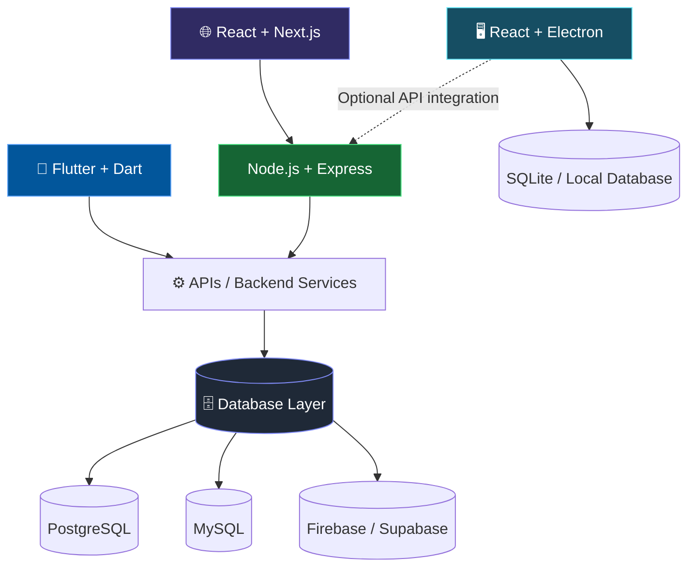

<div align="center">


<h1 align="center">SHOAIB ARSHAD</h1>

<p align="center"><b>FLUTTER & DART &nbsp;·&nbsp; FULL STACK &nbsp;·&nbsp; ELECTRON DESKTOP &nbsp;·&nbsp; DATABASES</b></p>

<a href="https://github.com/shabii804">
  
</a>

<br/><br/>

<p align="center">
  <a href="https://shoaibarshad-seven.vercel.app"></a>
  <a href="https://github.com/shabii804"></a>
  <a href="https://www.linkedin.com/in/shoaib-arshad-24200339b/"></a>
  <a href="https://www.instagram.com/shoaib_arshad80/"></a>
  <a href="https://www.facebook.com/profile.php?id=61594993012281"></a>
  <a href="mailto:YOUR-EMAIL"></a>
</p>

<p align="center">
  
  
</p>

<p align="center">
  
  
  
  
</p>

</div>


## ⚡ Developer Snapshot

```js
const shoaib = {
  name: "Shoaib Arshad",
  headline: "Flutter & Dart Developer",

  roles: [
    "Flutter & Dart Mobile App Developer",
    "Full Stack Web Developer",
    "Electron Desktop Application Developer",
    "Database Developer",
  ],

  mobile:    ["Flutter", "Dart"],
  frontend:  ["React", "Next.js", "JavaScript", "Tailwind CSS"],
  backend:   ["Node.js", "Express", "REST APIs"],
  desktop:   ["React", "Electron", "SQLite"],
  databases: ["SQL", "PostgreSQL", "MySQL", "Firebase", "Supabase"],

  education:  "BS Software Engineering @ Riphah International University",
  experience: "Remote Intern @ Developer Hub Corporation",
  base:       "Islamabad, Pakistan 🇵🇰",

  shipping: [
    "Mobile applications",
    "Full-stack web applications",
    "Cross-platform desktop software",
    "Database-driven systems",
  ],

  availability: "Open to internships, freelance & collaboration",
};
```

## 🧭 What I Do

<table>
<tr>
<td width="25%" valign="top" align="center">

<h3>📱</h3>

**Flutter & Dart**

Cross-platform mobile apps with responsive interfaces, authentication, API integration and backend connectivity.

</td>
<td width="25%" valign="top" align="center">

<h3>🌐</h3>

**Full Stack Web**

Modern web apps with React, Next.js, Node.js and Express, built with responsive UI and database integration.

</td>
<td width="25%" valign="top" align="center">

<h3>🖥️</h3>

**Desktop Apps**

Cross-platform desktop software with React and Electron, using local storage and databases where appropriate.

</td>
<td width="25%" valign="top" align="center">

<h3>🗄️</h3>

**Database Engineering**

Relational design, SQL queries, PostgreSQL, MySQL and cloud backends like Firebase and Supabase.

</td>
</tr>
</table>

## 🛠️ Skills & Technologies

<div align="center">

**📱 Mobile**<br/>


**🌐 Frontend**<br/>


**⚙️ Backend**<br/>


**🖥️ Desktop**<br/>


**🗄️ Databases & Cloud**<br/>


**💻 Languages**<br/>


**🧰 Tools**<br/>


</div>

## 🏗️ How My Stack Fits Together



## 🚀 Featured Projects

| Project | Description | Tech | Links |
|:--|:--|:--|:--|
| 💰 **SpendSmart** | Student expense tracker with budgets, analytics and financial insights | `React` `Vite` `Supabase` | [Live Demo](https://YOUR-LIVE-LINK) · [Source](https://github.com/shabii804/YOUR-REPO) |
| 🌐 **Farooq Agencies** | Business website for a medical supplies company | `React` `Firebase` `Tailwind CSS` | [Live Website](https://YOUR-LIVE-LINK) |
| 🏫 **School Management System** | Management app with admin, teacher and student roles | `Java Swing` `MySQL` | [Source](https://github.com/shabii804/YOUR-REPO) |
| 🏥 **Hospital Management System** | Hospital records project built on core data structures | `C++` | [Source](https://github.com/shabii804/YOUR-REPO) |

## 📊 GitHub Analytics

<div align="center">


</div>

## 🎯 Currently Focused On

- 📱 Building mobile applications with Flutter and Dart
- 🌐 Developing full-stack web apps with React and Next.js
- ⚙️ Creating APIs and backend services with Node.js and Express
- 🖥️ Building desktop applications with React and Electron
- 🗄️ Improving SQL, PostgreSQL and database architecture skills

## 🤝 Let's Build Something

I'm open to internships, freelance projects and collaboration across mobile development, full-stack web apps, Electron desktop software and database-driven systems.

<div align="center">

<a href="https://shoaibarshad-seven.vercel.app"></a>
<a href="https://www.linkedin.com/in/shoaib-arshad-24200339b/"></a>
<a href="https://www.instagram.com/shoaib_arshad80/"></a>
<a href="https://www.facebook.com/profile.php?id=61594993012281"></a>
<a href="mailto:YOUR-EMAIL"></a>

<br/><br/>


</div>
