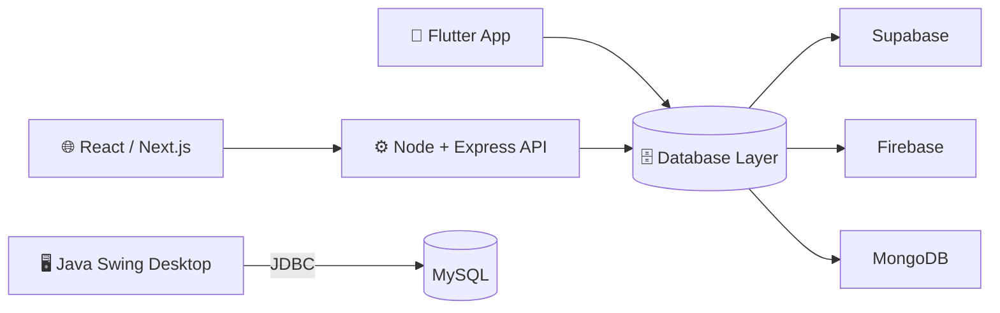

<!-- ============================ HERO ============================ -->
<div align="center">


<a href="https://shoaibarshad-seven.vercel.app">
  
</a>

<br/><br/>

<a href="https://shoaibarshad-seven.vercel.app"></a>
<a href="https://www.linkedin.com/in/shoaib-arshad-24200339b/"></a>
<a href="https://www.instagram.com/shoaib_arshad80/"></a>
<a href="https://www.facebook.com/profile.php?id=61594993012281"></a>
<a href="mailto:YOUR-EMAIL"></a>


<br/>


</div>

---

## ⚡ Developer Snapshot

```ts
const shoaib: Developer = {
  name: "Shoaib Arshad",
  roles: [
    "Full Stack Developer",
    "Flutter / Mobile App Developer",
    "Desktop Application Developer",
    "Database Developer & Manager",
  ],
  education: "BS Software Engineering, Riphah International University (CGPA 4.0)",
  experience: "Intern @ Developer Hub Corporation (remote)",
  base: "Islamabad, Pakistan 🇵🇰",
  currentlyBuilding: "SpendSmart: expense tracker (Flutter + Supabase)",
  shipping: ["Client websites", "Mobile apps", "Desktop systems"],
  availability: "Open to internships, freelance & collaboration",
};
```

---

## 🧭 What I Do

<table>
<tr>
<td width="25%" valign="top" align="center">
<h3>📱</h3>
<b>Mobile Development</b><br/><br/>
Cross-platform Flutter apps with authentication, cloud sync and clean UI
</td>
<td width="25%" valign="top" align="center">
<h3>🌐</h3>
<b>Full Stack Web</b><br/><br/>
Responsive Next and  React frontends with Node.js / Express APIs and secure data flow
</td>
<td width="25%" valign="top" align="center">
<h3>🖥️</h3>
<b>Desktop Applications</b><br/><br/>
Desktop Application with React and electron 
</td>
<td width="25%" valign="top" align="center">
<h3>🗄️</h3>
<b>Database Engineering</b><br/><br/>
Schema design, SQL, NoSQL and BaaS backends (Firebase, Supabase)
</td>
</tr>
</table>

---

## 🛠️ Skills & Technologies

### 📱 Mobile


### 🌐 Frontend


### ⚙️ Backend


### 🖥️ Desktop & Core Languages


### 🗄️ Databases & Cloud Backends


### 🧰 Tools & Workflow


---

## 🏗️ How My Stack Fits Together



---

## 🚀 Featured Projects

| | Project | What it does | Stack | Links |
|:-:|---|---|---|---|
| 📱 | **SpendSmart** | Student expense tracker with budgets and cloud sync | `Flutter` `Dart` `Supabase` | [Live](https://spend-smart-expensemanager.vercel.app) • [Code](https://github.com/shabii804/REPO-NAME) |
| 🌐 | **Farooq Agencies** | Client business website, live in production | `React` `Tailwind` | [Live](https://farooqagensies.com) |
| 🖥️ | **School Management System** | Mini LMS with role-based dashboards for Admin, Teacher and Student | `Java Swing` `MySQL` | [Code](https://github.com/shabii804/School-Mangment-System-Mini-FYP-) |
| 🏥 | **Hospital Management System** | Hospital records built on core data structures | `C++` | [Code](https://github.com/shabii804/Hospital-Management-System) |

---

## 📊 GitHub Analytics

<div align="center">


<br/>

</div>

---

## 🤝 Let's Build Something

I'm open to **internships, freelance projects and collaboration** across mobile, web, desktop and database work.

<div align="center">

<a href="https://shoaibarshad-seven.vercel.app"></a>
<a href="https://www.linkedin.com/in/shoaib-arshad-24200339b/"></a>
<a href="https://www.instagram.com/shoaib_arshad80/"></a>
<a href="https://www.facebook.com/profile.php?id=61594993012281"></a>
<a href="mailto:YOUR-EMAIL"></a>


</div>
