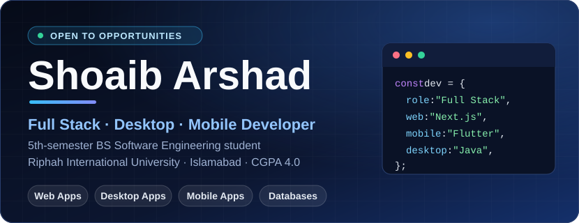
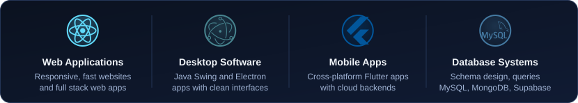
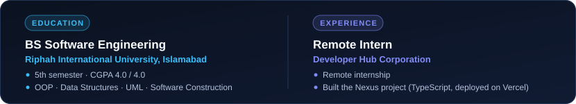
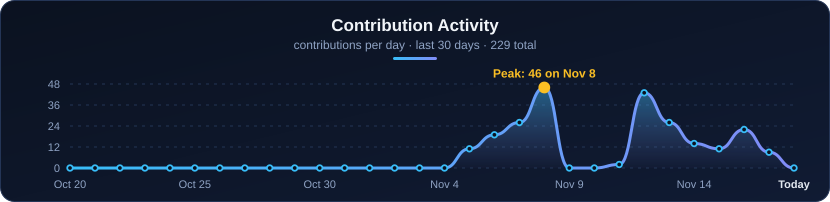
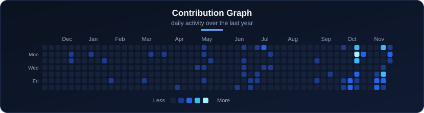

&nbsp;
&nbsp;
&nbsp;
&nbsp;

**5th-semester BS Software Engineering** student at **Riphah International University, Islamabad** · **4.0 CGPA** 
I build complete products: website, desktop app, mobile app and the database behind them. 
Remote intern at **Developer Hub Corporation** · Open to internships, freelance and collaborations.

🔭 **Currently:** building mobile apps with Flutter &amp; Supabase · learning software construction and UML design · improving my portfolio

<table>
<tr>
<td align="center" valign="top" width="270">
<b>💸 SpendSmart</b> 
Expense tracker with budgets and insights 
<code>Flutter</code> <code>Dart</code> <code>Supabase</code> 
<a href="https://spend-smart-expensemanager.vercel.app">Live</a> · <a href="https://github.com/shabii804/Spend-Smart">Code</a>
</td>
<td align="center" valign="top" width="270">
<b>📄 PrivyPDF</b> 
32 privacy-first PDF tools in your browser 
<code>HTML</code> <code>JavaScript</code> 
<a href="https://github.com/shabii804/Converter-tool">Code</a>
</td>
<td align="center" valign="top" width="270">
<b>🏫 School Management</b> 
Desktop app built with OOP (mini FYP) 
<code>Java</code> <code>Swing</code> 
<a href="https://github.com/shabii804/School-Mangment-System-Mini-FYP-">Code</a>
</td>
</tr>
<tr>
<td align="center" valign="top" width="270">
<b>🛍️ E-Shop Website</b> 
eCommerce frontend with Bootstrap UI 
<code>React</code> <code>Bootstrap</code> 
<a href="https://github.com/shabii804/E-Shop-Website">Code</a>
</td>
<td align="center" valign="top" width="270">
<b>👗 LuxeHer Fashion</b> 
Luxury fashion e-commerce website 
<code>HTML</code> <code>CSS</code> 
<a href="https://fashion-web-seven-peach.vercel.app">Live</a> · <a href="https://github.com/shabii804/Fashion-Web">Code</a>
</td>
<td align="center" valign="top" width="270">
<b>🧩 Nexus Project</b> 
Internship project on Vercel 
<code>TypeScript</code> 
<a href="https://nexus-project-by-shoaib.vercel.app">Live</a> · <a href="https://github.com/shabii804/Nexus-project">Code</a>
</td>
</tr>
</table>

<b>More academic projects</b>

🏥 <a href="https://github.com/shabii804/Hospital-Management-System">Hospital Management System</a> (C++, data structures) ·
🎓 <a href="https://github.com/shabii804/Student-Managment-in-Java-GUI-using-OOP">Student Management</a> (Java GUI, OOP) ·
📟 <a href="https://github.com/shabii804/School-Mangment-System-C-">School Management</a> (C++ console) ·
📱 <a href="https://github.com/shabii804/FlutterTasks">FlutterTasks</a> (mobile class tasks)

&nbsp;
&nbsp;

