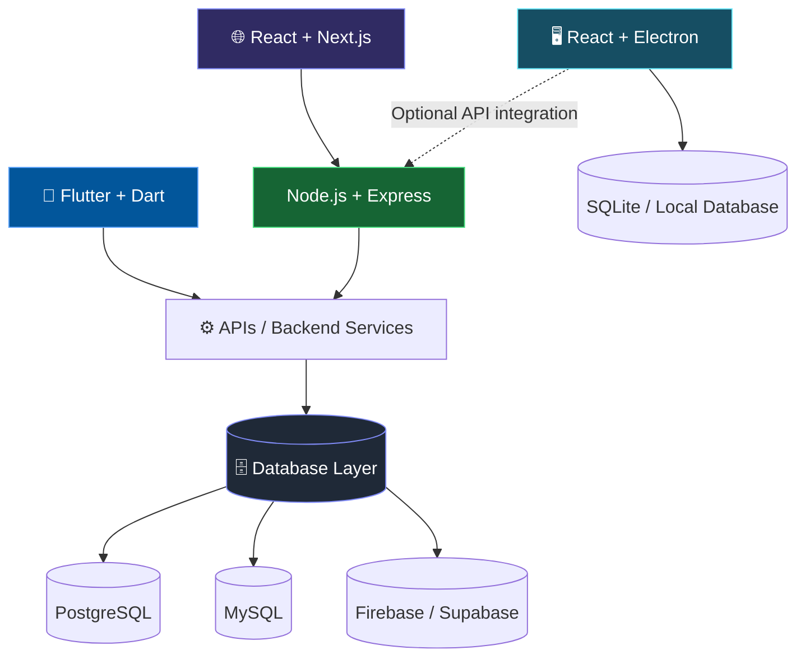

 <!-- ============================ PREMIUM HERO ============================ -->

<div align="center">


<a href="https://shoaibarshad-seven.vercel.app">

</a>

<br/><br/>

<a href="https://shoaibarshad-seven.vercel.app"></a>
<a href="https://www.linkedin.com/in/shoaib-arshad-24200339b/"></a>
<a href="https://www.instagram.com/shoaib_arshad80/"></a>
<a href="https://www.facebook.com/profile.php?id=61594993012281"></a>
<a href="mailto:YOUR-EMAIL"></a>

<br/><br/>


<br/><br/>


<br/><br/>


</div>

---

## ⚡ Developer Snapshot

```ts
const shoaib = {
  name: "Shoaib Arshad",

  headline: "Flutter & Dart Developer",

  roles: [
    "Flutter & Dart Mobile App Developer",
    "Full Stack Web Developer",
    "Electron Desktop Application Developer",
    "Database Developer",
  ],

  mobile: ["Flutter", "Dart"],

  frontend: ["React", "Next.js", "JavaScript"],

  backend: ["Node.js", "Express", "REST APIs"],

  desktop: ["React", "Electron"],

  databases: [
    "SQL",
    "PostgreSQL",
    "MySQL",
    "Firebase",
    "Supabase",
  ],

  education: "BS Software Engineering",

  experience: "Remote Intern @ Developer Hub Corporation",

  base: "Islamabad, Pakistan 🇵🇰",

  shipping: [
    "Mobile applications",
    "Full-stack web applications",
    "Cross-platform desktop software",
    "Database-driven systems",
  ],

  availability: "Open to internships, freelance & collaboration",
};
```

---

## 🧭 What I Do

<table>
<tr>
<td width="25%" valign="top" align="center">

<h3>📱</h3>

<b>Flutter & Dart Development</b>

<br/><br/>

Building cross-platform mobile applications with responsive interfaces, authentication, API integration and backend connectivity.

</td>
<td width="25%" valign="top" align="center">

<h3>🌐</h3>

<b>Full Stack Web Development</b>

<br/><br/>

Developing modern web applications using React, Next.js, Node.js and Express, with responsive UI and database integration.

</td>
<td width="25%" valign="top" align="center">

<h3>🖥️</h3>

<b>Desktop Application Development</b>

<br/><br/>

Creating cross-platform desktop applications using React and Electron, with local storage and database integration where appropriate.

</td>
<td width="25%" valign="top" align="center">

<h3>🗄️</h3>

<b>Database Engineering</b>

<br/><br/>

Working with relational databases, SQL queries, PostgreSQL, MySQL and cloud backends such as Firebase and Supabase.

</td>
</tr>
</table>

---

## 🛠️ Skills & Technologies

### 📱 Mobile Development


### 🌐 Frontend Development


### ⚙️ Backend Development


### 🖥️ Desktop Application Development


### 🗄️ Databases & Cloud Backends


### 💻 Programming Languages


### 🧰 Tools & Workflow


---

## 🏗️ How My Stack Fits Together



---

## 🚀 Featured Projects

| Project | Description | Technologies | Links |
|---|---|---|---|
| 💰 **SpendSmart** | Student expense tracker with budgets, expense analytics and financial insights | React, Vite, Supabase | [Live Demo](https://spend-smart-expense-manager.vercel.app) · [Source Code](https://github.com/shoaib-arshad123/Spend) |
| 🌐 **Farooq Agencies** | Business website for a medical supplies company | React, Firebase, Tailwind CSS | [Live Website](https://farooqagensies.com) |
| 🏫 **School Management System** | Management application with admin, teacher and student roles | Java Swing, MySQL | [Source Code](https://github.com/shabii804/School-Mangment-System-Mini-FYP-) |
| 🏥 **Hospital Management System** | Hospital records project using core data structures | C++ | [Source Code](https://github.com/shabii804/Hospital-Management-System) |

---

## 📊 GitHub Analytics

<div align="center">


<br/>


</div>

---

## 🎯 Currently Focused On

- 📱 Building mobile applications with Flutter and Dart.
- 🌐 Developing full-stack web apps with React and Next.js.
- ⚙️ Creating APIs and backend services with Node.js and Express.
- 🖥️ Building desktop applications with React and Electron.
- 🗄️ Improving SQL, PostgreSQL and database architecture skills.

---

## 🤝 Let's Build Something

I'm open to **internships, freelance projects and collaboration** across mobile development, full-stack web applications, Electron desktop software and database-driven systems.

<div align="center">

<a href="https://shoaibarshad-seven.vercel.app"></a>
<a href="https://www.linkedin.com/in/shoaib-arshad-24200339b/"></a>
<a href="https://www.instagram.com/shoaib_arshad80/"></a>
<a href="https://www.facebook.com/profile.php?id=61594993012281"></a>
<a href="mailto:YOUR-EMAIL"></a>

<br/><br/>


</div>
