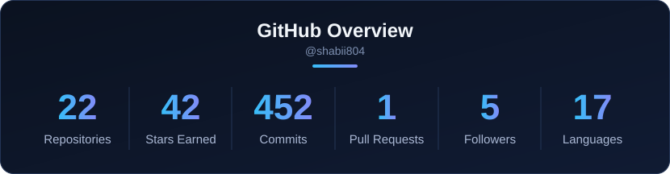

<!-- ============================ HERO ============================ -->
<div align="center">


<p>
  <a href="https://shoaibarshad-seven.vercel.app"></a>
  <a href="https://linkedin.com/in/shoaib-arshad-24200339b"></a>
  <a href="https://instagram.com/shoaib_arshad80"></a>
  <a href="https://facebook.com/profile.php?id=61594993012281"></a>
</p>


</div>

---

## ⚡ Who I Am

I'm **Shoaib**, a **5th-semester BS Software Engineering** student at **Riphah International University, Islamabad**, holding a **4.0 / 4.0 CGPA**. I build complete products end to end: the website, the desktop app, the mobile app and the database behind them.

<table>
<tr>
<td width="55%" valign="top">

- 🎓 **Studying:** Software Construction & Development, OOP, data structures and UML design
- 💼 **Experience:** remote intern at **Developer Hub Corporation**
- 🌐 **Web:** Next.js, React, Node.js and Express
- 🖥️ **Desktop:** Java Swing and React + Electron
- 📱 **Mobile:** Flutter with Supabase and Firebase
- 🗄️ **Databases:** MySQL, MongoDB, Firebase and Supabase

</td>
<td width="45%" valign="top">

```text
🎯 Goal      Become a professional
             full stack software engineer
🚀 Focus     Real projects over tutorials
📍 Based in  Islamabad, Pakistan
🤝 Open to   Internships, freelance,
             collaborations
```

</td>
</tr>
</table>

---

## 🛠️ What I Build

<table>
<tr>
<td width="25%" valign="top" align="center">

### 🌐 Web Apps
Fast, responsive, SEO-ready websites and dashboards.


</td>
<td width="25%" valign="top" align="center">

### 🖥️ Desktop Apps
Reliable desktop software with clean, usable interfaces.


</td>
<td width="25%" valign="top" align="center">

### 📱 Mobile Apps
Cross-platform apps with real cloud backends.


</td>
<td width="25%" valign="top" align="center">

### 🗄️ Databases
Schema design, queries and data management.


</td>
</tr>
</table>

<div align="center">


</div>

---

## 🚀 Featured Projects

<table>
<tr>
<td width="33%" valign="top">

#### 💸 SpendSmart
Expense tracker with budgets and spending insights.

`Flutter` `Dart` `Supabase`

[Live](https://spend-smart-expensemanager.vercel.app) · [Code](https://github.com/shabii804/Spend-Smart)

</td>
<td width="33%" valign="top">

#### 📄 PrivyPDF
32 privacy-first PDF tools that run 100% in your browser.

`HTML` `JavaScript` `Web`

[Code](https://github.com/shabii804/Converter-tool)

</td>
<td width="33%" valign="top">

#### 🏫 School Management System
Java Swing desktop app (mini FYP) built with OOP.

`Java` `Swing` `Desktop`

[Code](https://github.com/shabii804/School-Mangment-System-Mini-FYP-)

</td>
</tr>
<tr>
<td width="33%" valign="top">

#### 🛍️ E-Shop Website
eCommerce frontend built with React and Bootstrap.

`React` `Bootstrap` `Web`

[Code](https://github.com/shabii804/E-Shop-Website)

</td>
<td width="33%" valign="top">

#### 👗 LuxeHer Fashion
Luxury fashion e-commerce website.

`HTML` `CSS` `Web`

[Live](https://fashion-web-seven-peach.vercel.app) · [Code](https://github.com/shabii804/Fashion-Web)

</td>
<td width="33%" valign="top">

#### 🧩 Nexus Project
Internship project, deployed on Vercel.

`TypeScript` `Web`

[Live](https://nexus-project-by-shoaib.vercel.app) · [Code](https://github.com/shabii804/Nexus-project)

</td>
</tr>
</table>

<details>
<summary><b>More academic projects</b></summary>
<br/>

- 🏥 [Hospital Management System](https://github.com/shabii804/Hospital-Management-System): C++ with data structures
- 🎓 [Student Management in Java GUI](https://github.com/shabii804/Student-Managment-in-Java-GUI-using-OOP): Java GUI using OOP
- 📟 [School Management System (C++)](https://github.com/shabii804/School-Mangment-System-C-): console app using structures and files
- 📱 [FlutterTasks](https://github.com/shabii804/FlutterTasks): mobile application development class tasks

</details>

---

## 📊 GitHub Insights

<div align="center">
  
  
  <br/><br/>
  
</div>

<br/>

<div align="center">
  
</div>

---

## 🤝 Let's Work Together

Open to **internships, freelance projects and collaborations**: websites, desktop software, mobile apps and database systems.

<div align="center">

[](https://shoaibarshad-seven.vercel.app)
[](https://linkedin.com/in/shoaib-arshad-24200339b)


</div>
