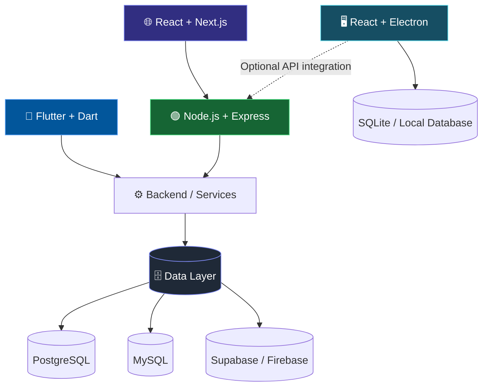

 <!-- ============================ PREMIUM HERO ============================ -->

<div align="center">


<br/>

<a href="https://readme-typing-svg.demolab.com">

</a>

<br/><br/>

<a href="https://shoaibarshad-seven.vercel.app">

</a>
<a href="https://github.com/shabii804">

</a>
<a href="https://www.linkedin.com/in/shoaib-arshad-24200339b/">

</a>
<a href="https://www.instagram.com/shoaib_arshad80/">

</a>

<br/><br/>


<br/>


</div>

---

<!-- ============================ ABOUT ME ============================ -->

## 👨‍💻 About Me

I'm **Shoaib Arshad**, a Software Engineering student and developer interested in building modern mobile, web, desktop, and database-driven applications.

I focus on creating practical software with clean interfaces, maintainable code, and reliable data management.

- 📱 **Mobile:** Flutter & Dart
- 🌐 **Full Stack:** React, Next.js, Node.js & Express
- 🖥️ **Desktop:** React & Electron
- 🗄️ **Databases:** SQL, PostgreSQL, MySQL & cloud backends
- 🎓 **Education:** BS Software Engineering
- 💼 **Experience:** Remote Developer Intern at Developer Hub Corporation
- 🤝 **Open to:** Internships, freelance projects, and collaboration

<br/>

<div align="center">

### Building useful software. Learning continuously. Shipping projects.

</div>

---

<!-- ============================ DEVELOPER SNAPSHOT ============================ -->

## ⚡ Developer Snapshot

```ts
const shoaib = {
  name: "Shoaib Arshad",
  title: "Software Developer",

  primarySpecialization: {
    mobile: ["Flutter", "Dart"],
    fullStackWeb: ["React", "Next.js", "Node.js", "Express"],
    desktop: ["React", "Electron"],
    databases: ["SQL", "PostgreSQL", "MySQL"],
  },

  cloudBackends: ["Firebase", "Supabase"],

  tools: ["Git", "GitHub", "VS Code", "Postman"],

  currentlyFocusedOn: [
    "Cross-platform mobile development",
    "Full-stack application development",
    "Desktop software engineering",
    "Database design and integration",
  ],

  availability: "Open to opportunities",
};
```

---

<!-- ============================ WHAT I DO ============================ -->

## 🧭 What I Do

<table>
<tr>
<td width="50%" valign="top">

### 📱 Flutter & Dart Development

Building cross-platform mobile experiences with Flutter and Dart.

- Responsive mobile interfaces
- Reusable widgets and layouts
- Form validation and authentication
- REST API integration
- Backend and database connectivity

</td>
<td width="50%" valign="top">

### 🌐 Full Stack Web Development

Building responsive, data-driven web applications.

- React and Next.js frontends
- Node.js and Express backends
- REST API development and integration
- Authentication and application logic
- Responsive UI with Tailwind CSS

</td>
</tr>
<tr>
<td width="50%" valign="top">

### 🖥️ Desktop Application Development

Developing desktop software using web technologies.

- React-based user interfaces
- Electron desktop applications
- Windows desktop software
- Local database integration
- Business and management systems

</td>
<td width="50%" valign="top">

### 🗄️ Database Development

Designing and integrating application data layers.

- SQL queries and relational databases
- PostgreSQL and MySQL
- Schema design and relationships
- Firebase and Supabase
- CRUD operations and data integration

</td>
</tr>
</table>

---

<!-- ============================ TECHNOLOGY STACK ============================ -->

## 🛠️ Technology Stack

### 📱 Mobile Development — Primary Focus

<p>


</p>

### 🌐 Frontend Development

<p>


</p>

### ⚙️ Backend Development

<p>


</p>

### 🖥️ Desktop Application Development

<p>


</p>

### 🗄️ Database & Cloud Technologies

<p>


</p>

### 💻 Programming Languages

<p>


</p>

### 🧰 Tools & Workflow

<p>


</p>

---

<!-- ============================ ARCHITECTURE ============================ -->

## 🏗️ How My Technologies Work Together



---

<!-- ============================ FEATURED PROJECTS ============================ -->

## 🚀 Featured Projects

<table>
<tr>
<th>Project</th>
<th>Description</th>
<th>Technologies</th>
<th>Links</th>
</tr>

<tr>
<td><b>💰 SpendSmart</b></td>
<td>Expense tracking application for managing budgets, expenses and financial insights.</td>
<td>React / Vite, Supabase, JavaScript</td>
<td><a href="https://spend-smart-expense-manager.vercel.app">Live Demo</a> · <a href="https://github.com/shoaib-arshad123/Spend">Source Code</a></td>
</tr>

<tr>
<td><b>🏥 Farooq Agencies</b></td>
<td>Business website for a medical supplies company.</td>
<td>React, Firebase, Tailwind CSS</td>
<td><a href="https://farooqagensies.com">Live Website</a></td>
</tr>

<tr>
<td><b>🏫 School Management System</b></td>
<td>Role-based school management application with administrative, teacher and student functionality.</td>
<td>Java Swing, MySQL, JDBC</td>
<td><a href="https://github.com/shabii804/School-Mangment-System-Mini-FYP-">Source Code</a></td>
</tr>

<tr>
<td><b>🏥 Hospital Management System</b></td>
<td>Hospital record management project using core data structures.</td>
<td>C++</td>
<td><a href="https://github.com/shabii804/Hospital-Management-System">Source Code</a></td>
</tr>
</table>

---

<!-- ============================ GITHUB ANALYTICS ============================ -->

## 📊 GitHub Analytics

<div align="center">


<br/>


<br/>


</div>

---

<!-- ============================ CURRENT FOCUS ============================ -->

## 🎯 Current Focus

- 📱 Improving my Flutter and Dart mobile development skills.
- 🌐 Building responsive full-stack web applications.
- 🖥️ Exploring production-ready desktop applications with React and Electron.
- 🗄️ Improving SQL, PostgreSQL and database architecture skills.
- 🚀 Building projects that solve real-world problems.

---

<!-- ============================ CONNECT ============================ -->

## 🤝 Let's Connect & Build Something

I'm open to software development internships, freelance opportunities, collaborative projects and learning from other developers.

<div align="center">

<a href="https://shoaibarshad-seven.vercel.app">

</a>
<a href="https://www.linkedin.com/in/shoaib-arshad-24200339b/">

</a>
<a href="https://github.com/shabii804">

</a>

<br/><br/>

### 💜 Thanks for visiting my profile!


</div>
