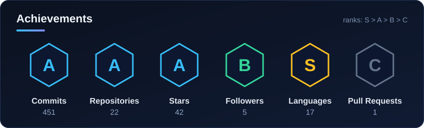

 

 

## About Me

I'm a **5th-semester BS Software Engineering** student at **Riphah International University, Islamabad** with a **4.0 / 4.0 CGPA**. I build complete products from end to end: the website, the desktop app, the mobile app and the database behind them. I'm currently a remote intern at **Developer Hub Corporation**.

| | |
|---|---|
| 🎓 **Studying** | Software Construction & Development, OOP, data structures, UML modeling |
| 💼 **Experience** | Remote intern at Developer Hub Corporation |
| 🛠️ **Build** | Web apps, desktop apps, mobile apps, database systems |
| 🎯 **Goal** | Grow into a professional full stack software engineer |
| 📍 **Location** | Islamabad, Pakistan |
| 🤝 **Open to** | Internships, freelance projects and collaborations |

 

## Tech Stack

### Programming Languages

### Web Development

### Mobile and Desktop Development

### Databases and Backend Services

### Tools and Platforms

-0f172a?style=for-the-badge)

### Core Concepts
`OOP` &nbsp; `Data Structures` &nbsp; `UML Modeling` &nbsp; `REST APIs` &nbsp; `Database Design` &nbsp; `Responsive UI` &nbsp; `Software Construction`

 

## Featured Projects

| Project | What it is | Stack | Links |
|---|---|---|---|
| 💸 **SpendSmart** | Expense tracker with budgets and spending insights | Flutter · Dart · Supabase | [Live](https://spend-smart-expensemanager.vercel.app) · [Code](https://github.com/shabii804/Spend-Smart) |
| 📄 **PrivyPDF** | 32 privacy-first PDF tools that run 100% in the browser | HTML · JavaScript | [Code](https://github.com/shabii804/Converter-tool) |
| 🏫 **School Management System** | Desktop app built with OOP (mini FYP) | Java · Swing | [Code](https://github.com/shabii804/School-Mangment-System-Mini-FYP-) |
| 🛍️ **E-Shop Website** | eCommerce frontend with a Bootstrap UI | React · Bootstrap | [Code](https://github.com/shabii804/E-Shop-Website) |
| 👗 **LuxeHer Fashion** | Luxury fashion e-commerce website | HTML · CSS | [Live](https://fashion-web-seven-peach.vercel.app) · [Code](https://github.com/shabii804/Fashion-Web) |
| 🧩 **Nexus Project** | Internship project deployed on Vercel | TypeScript | [Live](https://nexus-project-by-shoaib.vercel.app) · [Code](https://github.com/shabii804/Nexus-project) |

<b>More academic projects</b>

 

- 🏥 [Hospital Management System](https://github.com/shabii804/Hospital-Management-System): C++ with data structures
- 🎓 [Student Management in Java GUI](https://github.com/shabii804/Student-Managment-in-Java-GUI-using-OOP): Java GUI using OOP
- 📟 [School Management System (C++)](https://github.com/shabii804/School-Mangment-System-C-): console app using structures and files
- 📱 [FlutterTasks](https://github.com/shabii804/FlutterTasks): mobile application development class tasks

 

## GitHub Insights

  

  

 

 

## Let's Connect

I'm open to **internships, freelance work and collaborations** on websites, desktop software, mobile apps and database systems.

