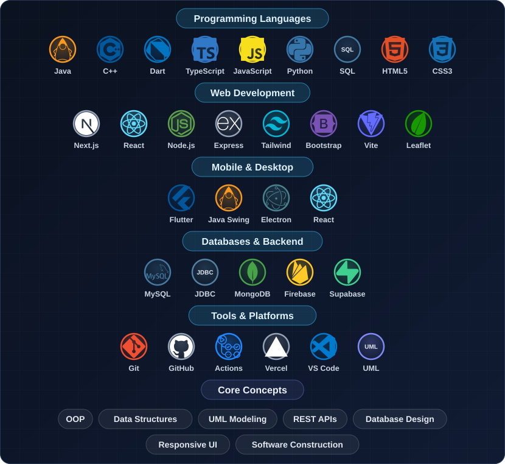
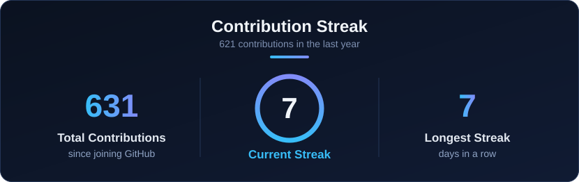
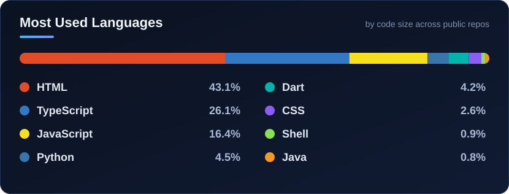

 

&nbsp;&nbsp;
&nbsp;&nbsp;
&nbsp;&nbsp;
&nbsp;&nbsp;

  

I'm a **5th-semester BS Software Engineering** student at **Riphah International University, Islamabad** with a **4.0 / 4.0 CGPA**. 
I build complete products end to end: the website, the desktop app, the mobile app and the database behind them. 
Currently a remote intern at **Developer Hub Corporation**.

 

<table>
<tr>
<td align="center" width="200"><h3>🎓</h3><b>Studying</b> OOP · Data Structures UML · Software Construction</td>
<td align="center" width="200"><h3>💼</h3><b>Experience</b> Remote Intern Developer Hub Corporation</td>
<td align="center" width="200"><h3>🛠️</h3><b>I Build</b> Web · Desktop Mobile · Databases</td>
</tr>
<tr>
<td align="center" width="200"><h3>🎯</h3><b>Goal</b> Professional Full Stack Engineer</td>
<td align="center" width="200"><h3>📍</h3><b>Location</b> Islamabad Pakistan</td>
<td align="center" width="200"><h3>🤝</h3><b>Open To</b> Internships · Freelance Collaborations</td>
</tr>
</table>

 

 

<table>
<tr>
<td align="center" valign="top" width="270">
<h3>💸 SpendSmart</h3>
Expense tracker with budgets and spending insights  
<code>Flutter</code> <code>Dart</code> <code>Supabase</code>  
<a href="https://spend-smart-expensemanager.vercel.app">Live Demo</a> · <a href="https://github.com/shabii804/Spend-Smart">Code</a>
</td>
<td align="center" valign="top" width="270">
<h3>📄 PrivyPDF</h3>
32 privacy-first PDF tools that run 100% in your browser  
<code>HTML</code> <code>JavaScript</code>  
<a href="https://github.com/shabii804/Converter-tool">Code</a>
</td>
<td align="center" valign="top" width="270">
<h3>🏫 School Management</h3>
Desktop app built with OOP (mini FYP)  
<code>Java</code> <code>Swing</code>  
<a href="https://github.com/shabii804/School-Mangment-System-Mini-FYP-">Code</a>
</td>
</tr>
<tr>
<td align="center" valign="top" width="270">
<h3>🛍️ E-Shop Website</h3>
eCommerce frontend with a Bootstrap UI  
<code>React</code> <code>Bootstrap</code>  
<a href="https://github.com/shabii804/E-Shop-Website">Code</a>
</td>
<td align="center" valign="top" width="270">
<h3>👗 LuxeHer Fashion</h3>
Luxury fashion e-commerce website  
<code>HTML</code> <code>CSS</code>  
<a href="https://fashion-web-seven-peach.vercel.app">Live Demo</a> · <a href="https://github.com/shabii804/Fashion-Web">Code</a>
</td>
<td align="center" valign="top" width="270">
<h3>🧩 Nexus Project</h3>
Internship project deployed on Vercel  
<code>TypeScript</code>  
<a href="https://nexus-project-by-shoaib.vercel.app">Live Demo</a> · <a href="https://github.com/shabii804/Nexus-project">Code</a>
</td>
</tr>
</table>

<b>More academic projects</b>

 

🏥 [Hospital Management System](https://github.com/shabii804/Hospital-Management-System) · C++ with data structures 
🎓 [Student Management in Java GUI](https://github.com/shabii804/Student-Managment-in-Java-GUI-using-OOP) · Java GUI using OOP 
📟 [School Management System (C++)](https://github.com/shabii804/School-Mangment-System-C-) · console app using structures and files 
📱 [FlutterTasks](https://github.com/shabii804/FlutterTasks) · mobile application development class tasks

 

  

  

  

  

  

 

I'm open to **internships, freelance work and collaborations** on websites, desktop software, mobile apps and database systems.

 

&nbsp;&nbsp;
&nbsp;&nbsp;

 

